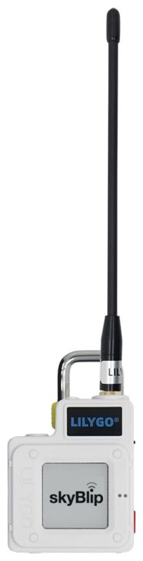

# skyBlip

Open-source electronic conspicuity for general aviation: [ADS-L 4 SRD-860](https://www.easa.europa.eu/en/document-library/agency-decisions/ed-decision-2022024r) for aircraft (skyBlip) and ground stations (skyPost).

## What it does

[`docs/BEHAVIOR.md`](docs/BEHAVIOR.md) lists every claim the firmware makes about itself, straight from the host test suite that checks them. It is generated, so it cannot describe a behavior that stopped being true.

[`docs/TUNING.md`](docs/TUNING.md) is the other half: every number that behavior is tuned by, with the line of source that justifies it. Also generated, from the constants themselves.

## The hardware

skyBlip runs on the LilyGO T-Echo: a T-Echo Plus, the reference board for the tracker, is a skyBlip Go+, and a plain T-Echo, without the inertial unit, the buzzer and the vibration motor, is a skyBlip Go. skyBlip Bravo is a Seeed SenseCAP MeshTracker X1 that will run skyBlip firmware as a receive-only ADS-B 1090 MHz receiver. The X1 is on sale with Meshtastic, and the Bravo firmware is in development: [skyblip.eu/bravo](https://skyblip.eu/bravo). A Go paired with a Bravo is a skyBlip Tango, and a Go+ paired with a Bravo a Tango+: [skyblip.eu/tango](https://skyblip.eu/tango). The devices after them are on [skyblip.eu/roadmap](https://skyblip.eu/roadmap).



| | T-Echo Plus (skyBlip Go+) |
|---|---|
| **Processor** | Nordic nRF52840, Cortex-M4F, 64 MHz |
| **GNSS** | Quectel L76K, PPS |
| **868 MHz radio** | Semtech SX1262 |
| **Barometer** | Bosch BME280 |
| **Inertial unit** | Bosch BHI260AP |
| **Display** | 1.54" e-paper, 200x200 |
| **Audible alarms** | buzzer + vibration motor |
| **Bluetooth** | BLE 5.0, 3 connections, no pairing |
| **USB** | USB-C |
| **Battery** | 2400 mAh Li-ion |

<br clear="right">

## The tree

| Directory | What lives there |
|---|---|
| [`firmware/`](firmware) | the C++ tree: `core/`, `ui/`, `ports/`, the Zephyr platform, the host test suite, and the simulator's world |
| [`server/`](server) | [skyblip.eu](https://skyblip.eu), public content and the device tools under `/briefing`, served by Rails on crooz |
| `docs/`, `schemas/`, `scripts/`, `lib/` | the generated behavior and tuning indexes, the wire schemas, the build and release tooling and its Ruby logic |

The firmware and the server share a tree so that a change in behavior and the page documenting it can land in one commit. They do not share a build: each has its own workflow, gated on the paths it owns. Firmware releases include the browser simulator runtime. Rails discovers releases through separate Turbo Frame requests, so publishing firmware does not redeploy the server.

## Building

The host test suite and the simulator need nothing but a C++ compiler: `make -C firmware test`, `make -C firmware simulator`.

The device image is built off a committed ref, `main` by default, into `builds/`:

```
scripts/build_local.sh              # skyblip_go, the only product today
SKYBLIP_REF=HEAD scripts/build_local.sh
```

The first run needs `cmake ninja dtc gperf`, then bootstraps a Zephyr workspace under `~/.cache/skyblip/west` and installs the SDK under `~/.local/opt`.

CI builds it too, and which key signs it decides which units it can update over Bluetooth ([`firmware/keys/`](firmware/keys)):

- a pull request: a key made for the run, so the build is proven and the image updates nothing;
- `main`, or a branch run by hand: the development key, published by [`firmware.yml`](.github/workflows/firmware.yml) as one pre-release per product on the Releases page, `dev-<build number>` for `main` (the last three kept) and `dev-<build number>-<branch>` for a branch (its newest kept until its pull request closes). Every product but the Go puts its name in front, as in `bravo-dev-<build number>`, and keeps its own three;
- a product's tag on `main`, `v*` for the Go and `bravo-v*` for Bravo: the production key, after an approval, into a draft release ([`release.yml`](.github/workflows/release.yml)). The tag must equal that product's `VERSION`. Bravo's tags release only once the `firmware_production` environment admits them ([`server/DEPLOYMENT.md`](server/DEPLOYMENT.md), #204).

Each release holds one product's images, named `skyblip-<product>-<version or dev tag>`, with the simulator, the license texts and a `SHA256SUMS` over all of them. A product with no sensor hub has no `.full.signed.bin`.

The build number after the `+` is the commit count. A unit on the production key refuses an image older than the one it runs, so it only goes up or installs the same version again. A unit on the development key takes any development image, older ones included. Drag-and-drop of a `.uf2` takes either anywhere.

## Identifiers

Three identifiers name skyBlip to the outside world, and two of them are ours so far.

- **ADS-L address table**: manufacturer page 49, which is AMT entry 58, with manufacturer prefix 0, assigned by the ADS-L registry on 5 October 2026 (ticket #228794). The assignment carries a prefix, so it is the structured scheme of F.2.2 rather than the flat 24-bit space we applied for: the 16 bits below the prefix are ours to fill densely, one per unit. Both are constants in [`firmware/core/settings/address.h`](firmware/core/settings/address.h), and each unit gets its 16 bits at [skyblip.eu/activate](https://skyblip.eu/activate): the server assigns the serial against the unit's FICR id and signs it, and until a unit holds one it neither transmits nor receives ([`firmware/core/identity/`](firmware/core/identity)). The exchange with the registry is logged on [skyblip.eu/ads-l-registry](https://skyblip.eu/ads-l-registry).
- **USB**: Vendor ID 0x1209, Product ID 0x5AFE, granted by [pid.codes](https://pid.codes/1209/5AFE/) on 2 October 2026 ([pull request #1282](https://github.com/pidcodes/pidcodes.github.com/pull/1282)) and set in [`firmware/products/skyblip_go/prj.conf`](firmware/products/skyblip_go/prj.conf). It names the running application only: the bootloader presents Adafruit's factory descriptors.
- **NMEA manufacturer code**: open. The `$PADSL`, `$PADSI` and `$PADSO` sentences sketched on [skyblip.eu/ads-l-registry/nmea](https://skyblip.eu/ads-l-registry/nmea) need a three-letter code that NMEA assigns: either one of our own, or an ADS code held by ADS-L's registry or working group, so the sentences belong to the specification rather than to one implementer.

## Acknowledgements

skyBlip stands on a decade of open work by the free-flight community. Thanks to the authors of the projects we learned from while building it:

- **Paweł Jałocha**: the ADS-L reference implementation and [nrf52-ogn-tracker](https://github.com/pjalocha/nrf52-ogn-tracker)
- **Linar Yusupov**: [SoftRF](https://github.com/lyusupov/SoftRF)
- **Moshe Braner**: the [SoftRF fork](https://github.com/moshe-braner/SoftRF)

## License

The repository is **MIT**: see [`LICENSE`](LICENSE). That covers the firmware, the server, the schemas and the build and release tooling. Any of it may go into another product, open or closed.

A few files in the tree are other people's work under their own terms: Bosch Sensortec's image for the inertial unit, the web fonts and EASA's ADS-L specification. A firmware image is also built from Zephyr, its modules and the toolchain's libraries, and the simulator's WASM from Emscripten's runtime. [`NOTICE.md`](NOTICE.md) lists each one with its license, and every release ships it beside the image.

## Trademark

"skyBlip" and "skyPost", the wordmark and the airship mark are trademarks of François Catuhe. The licenses above grant copyright permissions, not trademark ones: a fork may say it is compatible with skyBlip or derived from it, and may not use the names or the marks to name its own product or to suggest endorsement.

Copyright (C) 2026 François Catuhe
